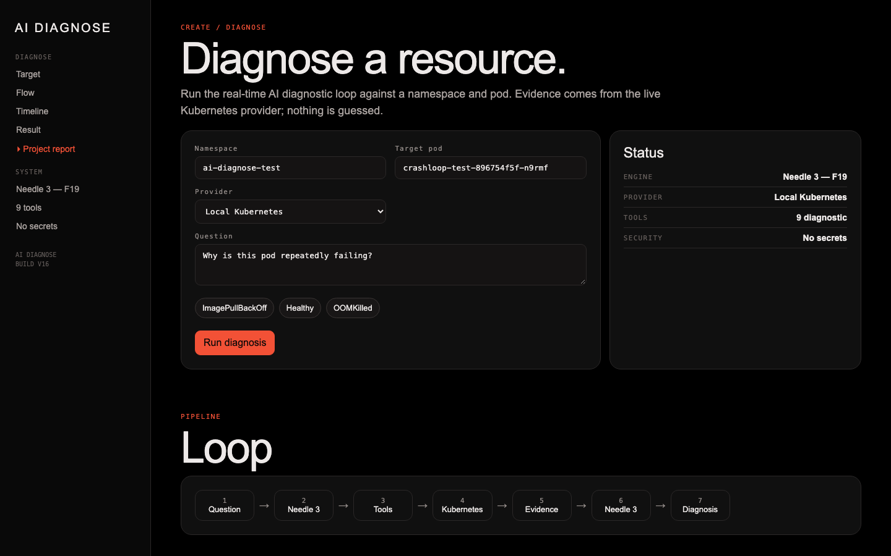
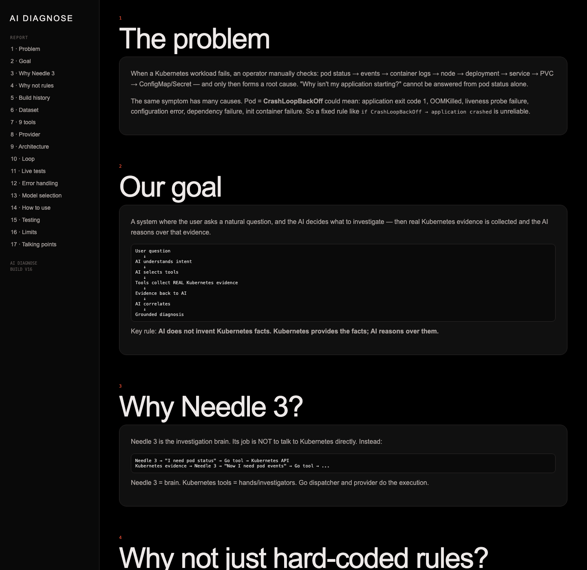

# stack8s-ai-diagnose

AI-driven Kubernetes diagnosis for Stack8s. You ask a question about a namespace/pod, Needle 3 F19 picks the right diagnostic tools, Go executes them against the real cluster through the provider boundary, and the runtime returns a grounded, evidence-backed diagnosis.

## Live demo report

Report page (while server is running): `http://localhost:8080/report.html`

## Screenshots

### Main diagnostic UI



### Project report page



## Architecture

```
User question + namespace + pod
        │
        ▼
 Diagnostic API
        │
        ▼
 Diagnostic loop
        │
        ▼
 Needle 3 F19 (intent + tool selection)
        │
        ▼
 Go Dispatcher
        │
        ▼
 InfrastructureProvider
   ├── LocalKubernetesProvider (client-go, KUBECONFIG-aware)
   ├── FakeProvider (tests)
   └── Stack8sProvider (future)
        │
        ▼
 Real Kubernetes evidence
        │
        ▼
 Causal synthesis (Needle 3 F19 advisory)
        │
        ▼
 Diagnosis + Root Cause + Evidence + Next Step
```

## Features

- Intent-aware tool selection (GPU/storage/service/config/workload/node/pod)
- Exact target propagation from API to every tool call
- Container discovery from pod-status evidence (no hardcoded container names)
- Pending vs Pending but unscheduled reasoning
- Liveness vs readiness vs startup probe semantics
- Init container failures reported separately
- Multi-container attribution (app vs sidecar vs init)
- RESOURCE_NOT_FOUND stops investigation instead of fabricating a failure
- Empty results reported honestly (for example: no services in namespace)
- Secret values never collected; provider is read-only

## Usage

```bash
export KUBECONFIG=/path/to/stack8s-kubeconfig.yaml
export STACK8S_PROVIDER=local-kubernetes

# Run the UI + API server
venv/bin/python3 runtime/server.py 8080
# open http://localhost:8080

# CLI
go run ./cmd/diagnose --namespace ai-diagnose-test --pod crashloop-test-896754f5f-n9rmf --question "Why is this pod repeatedly failing?"

# Execute a single tool
go run ./cmd/tool_exec --tool get_pod_status --args '{"namespace":"ai-diagnose-test","pod":"crashloop-test-896754f5f-n9rmf"}'

# Check which cluster the provider targets
go run ./cmd/tool_exec --print-target
```

## Tools

`get_pod_status`, `get_pod_events`, `get_container_logs`, `get_node_status`, `get_gpu_status`, `get_service_status`, `get_storage_status`, `get_workload_status`, `get_configuration_status`

## Testing

```bash
go test -v ./...
go vet ./...
venv/bin/python3 -m unittest runtime.test_diagnostic_loop -v
```

41 runtime tests cover target propagation, KUBECONFIG honoring, CrashLoop, image pull, OOMKilled, pending scheduling lattice, init containers, probes, multi-container, resource-not-found, and the GPU/service/storage/config/workload domains.

## Dataset & model

- Needle 3 F19 checkpoint: `checkpoints/needle3.safetensors` (validated production model)
- Audited Dataset V3: 383 train / 97 validation / 68 test, built from controlled Kubernetes failures and documentation-derived cases
- Fine-tuned with LoRA on Kaggle T4; evaluated on a holdout split

## Security & safety boundaries

- No credentials in the frontend
- Secrets are never collected (metadata only)
- Diagnostics are read-only; no delete/restart/scale/edit
- A correct uncertainty response is always preferred over a guessed diagnosis
